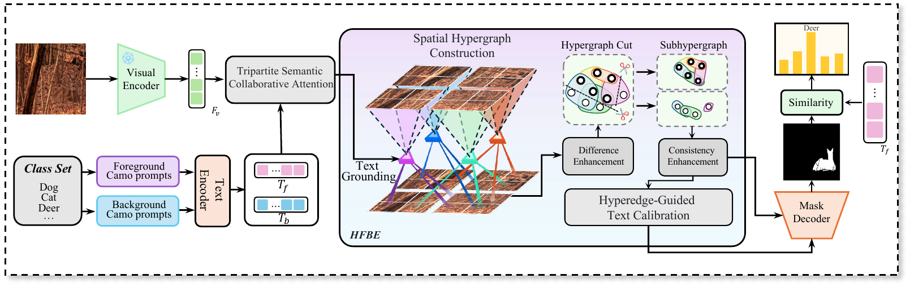

# Hyper-CamoSeg: Hypergraph Cut-Guided Feature Disentanglement for Open-Vocabulary Camouflaged Object Segmentation

## 摘要

Open-vocabulary camouflaged object segmentation (OVCOS) aims to segment camouflaged objects from open-set categories based on textual descriptions. Owing to the high visual similarity between camouflaged objects and their backgrounds, accurately localizing target objects and delineating their fine-grained boundaries remain highly challenging. Existing methods typically leverage vision–language models (VLMs) to introduce open-vocabulary semantics. However, VLMs tend to emphasize global semantic alignment and therefore exhibit limited fine-grained perceptual capabilities. Relying solely on cross-modal attention is insufficient to overcome this limitation. To address these issues, we propose Hyper-CamoSeg, a hypergraph cut-guided framework for open-vocabulary camouflaged object segmentation. First, we introduce dual foreground–background prompts and design a Tripartite Semantic Collaborative Attention (TSCA) module to facilitate interactions among visual features and the textual features of both the foreground and background. Second, we propose a Hypergraph Cut-Guided Foreground–Background Enhancement (HFBE) module. It first mines latent high-order correlations among visual tokens and then performs a hypergraph cut by integrating textual semantics with structural information, thereby partitioning the hypergraph into foreground and background subhypergraphs. High-order message passing is subsequently conducted within each subhypergraph to enhance intra-region consistency, while hyperedge semantics are employed to calibrate the textual representations. Experimental results on the OVCamo dataset demonstrate that Hyper-CamoSeg achieves competitive performance across all evaluation metrics.

## 1.引言

伪装物体分割（Camouflaged Object Segmentation，COS）旨在从复杂场景中定位并分割与周围环境高度相似的目标，在野生动物保护、农业监测和工业缺陷检测等领域具有重要应用价值。与显著目标不同，伪装物体通常通过相近的颜色、纹理和结构融入背景，其边界与局部形态也容易受到遮挡和环境干扰。近年来，多尺度融合、边界建模、上下文推理等技术显著提升了伪装目标的感知能力~\cite{fan2020sinet,mei2021pfnet,pang2022zoomnet,huang2023fspnet}。然而，这些方法大多采用封闭类别或类别无关设定，既难以识别训练阶段未见的目标类别，也无法根据自然语言概念灵活理解伪装场景。

开放词汇伪装物体分割（OVCOS）要求模型依据候选文本类别，同时预测伪装目标的像素级掩码和语义类别~\cite{pang2024ovcos}。CLIP~\cite{radford2021clip} 等视觉—语言模型通过大规模图文预训练获得了良好的开放类别泛化能力，为识别训练阶段未见的伪装目标提供了语义基础。现有方法进一步采用迭代语义引导、上下文感知提示和双向跨模态对齐等策略改善视觉—文本匹配~\cite{pang2024ovcos,ren2025suclip,zhang2026baclip}，但仍面临两个问题：一方面，视觉—语言模型偏重全局语义建模，对局部纹理、边界和细微结构差异的感知能力有限，仅依赖跨模态注意力难以充分弥补这一缺陷；另一方面，局部聚合或邻域平滑通常在前景与背景尚未可靠分离时进行，容易使跨区域信息相互传播，进一步加剧伪装场景中的语义混淆。

为此，本文提出由超图割引导的开放词汇伪装物体分割框架 **Hyper-CamoSeg**。本文在文本提示中同时引入与候选类别相关的前景和背景语义，为视觉—文本交互提供更充分的语义参照。首先，双向语义交互注意力模块（BSIA）通过建模视觉特征与前景、背景文本的双向关联，增强目标相关语义并校准文本表示。随后，超图割引导的前景—背景增强模块（HFBE）利用超图刻画视觉 token 间的高阶关系，通过语义引导的超图划分切断跨区域传播，并在子超图内进行结构增强。最终，融合后的视觉特征与文本提示共同用于掩码预测和类别识别。

我们的主要贡献概括如下：

1.我们提出 Hyper-CamoSeg，协同建模跨模态语义交互与高阶结构关系，以提升开放词汇伪装场景中的细粒度目标感知能力。

2.我们提出三方语义协同注意力 BSIA，通过前景增强、背景抑制以及视觉—文本双向校准，提高伪装场景中的跨模态语义判别能力。

3.我们将超图割引入开放词汇伪装物体分割，采用割前差异增强、割后区域一致性传播的双阶段策略缓解了伪装场景下的前景-背景特征混淆问题。

## 2.相关工作

### 2.1 OVCOS

传统伪装物体分割主要通过多尺度融合、边界建模和上下文推理提升目标感知能力~\cite{fan2020sinet,mei2021pfnet,pang2022zoomnet,huang2023fspnet}，但通常采用封闭类别或类别无关设定，难以识别训练阶段未见的目标。受 CLIP~\cite{radford2021clip} 启发，LSeg~\cite{li2022lseg}、SAN~\cite{xu2023san} 和 CAT-Seg~\cite{cho2024catseg} 等开放词汇分割方法通过视觉—文本对齐实现新类别迁移，但在前景与背景高度相似的伪装场景中仍易产生局部混淆。

Pang 等人~\cite{pang2024ovcos} 首次提出 OVCOS 任务及 OVCoser，通过语义引导和结构线索完成分割与分类。随后，SuCLIP~\cite{ren2025suclip} 和 BaCLIP~\cite{zhang2026baclip} 分别从上下文提示、特征选择和双向跨模态交互等方面改善视觉—文本对齐，训练自由方法~\cite{ren2026trainingfree} 则借助多模态大模型生成目标与背景描述。现有方法主要关注提示学习和跨模态对齐，对前景与背景之间的高阶结构连接缺乏显式约束。本文引入文本与结构联合引导的超图割，以限制跨语义区域的信息传播。

### 2.2 超图学习

超图中的一条超边可同时连接多个节点，因此适合建模视觉区域之间的高阶关系。Zhou 等人~\cite{zhou2006hypergraph} 奠定了超图谱学习的理论基础，随后 HGNN~\cite{feng2019hgnn}、HyperGCN~\cite{yadati2019hypergcn} 和 DHGNN~\cite{jiang2019dhgnn} 分别从超图卷积、图近似和动态结构学习等方面提升了高阶关系建模能力。超图也被用于语义分割，例如 HyperGCN-WSS~\cite{giraldo2022hypergcnwss} 通过空间与近邻关系传播弱监督信号。

现有深度超图方法主要通过节点—超边—节点聚合增强区域一致性，较少利用超图割主动约束传播路径。早期超图割研究虽被用于前景—背景传播和视频显著目标提取~\cite{ding2008image,huang2009video,kim2011higher}，但通常作为独立的聚类过程。本文将超图割嵌入特征传播，先切断前景与背景之间的跨语义连接，再在子超图内部进行一致性增强，从而兼顾区域完整性与语义分离。

# 3. 方法

## 3.1 整体框架

**Hyper-CamoSeg 整体框架。** TSCA 实现前景、背景文本与视觉特征的三向交互，HFBE 进一步完成差异增强、超图割、子超图一致性增强与文本校准。最终，通过掩码池化提取目标视觉特征，并与候选类别文本特征匹配以预测类别。

Hyper-CamoSeg 的整体框架如图 X 所示。给定图像 $I$ 和候选类别集合$\mathcal{C}=\{c_n\}_{n=1}^{N}$，冻结的 CLIP 编码器提取多尺度视觉特征及前景、背景文本特征 $T_f$ 和 $T_b$。BSIA 通过双向跨模态交互生成增强视觉特征 $F_{tri}$ 和图像自适应文本特征 $T_f^{\mathrm{tri}}$、$T_b^{\mathrm{tri}}$。随后，HFBE 依次进行差异增强、前景-背景超图割和子超图一致性传播，得到视觉特征 $F_h$ 和全局文本提示 $E_t$。最后，将 $F_h$ 与多尺度特征融合得到 $E_v$，并结合 $E_t$ 预测掩码 $\hat{Y}$；目标类别 $\hat{c}$ 由掩码区域视觉特征与候选类别文本特征的相似度确定。

------

## 3.2 三方语义协同注意力（ TSCA）

 TSCA 首先将 CLIP 视觉特征展平并投影为视觉 token $X\in\mathbb{R}^{P\times d}$，其中 $P$ 为空间位置数量。随后，以 $X$ 为查询，分别与前景文本 $T_f$ 和背景文本 $T_b$ 进行多头交叉注意力，得到前景响应 $X_f=\mathcal{A}(X,T_f,T_f)$ 和背景响应 $X_b=\mathcal{A}(X,T_b,T_b)$。其中，$\mathcal{A}(Q,K,V)$表示多头交叉注意力。最后，结合原始视觉特征、两类语义响应及其差异，生成前景增强门控 $g_f$ 和背景抑制门控 $g_b$：
$$
[g_f,g_b]
=
\sigma\!\left(
\operatorname{MLP}
\left(
[X\Vert X_f\Vert X_b\Vert(X_f-X_b)]
\right)
\right),
$$
其中，$g_f,g_b\in\mathbb{R}^{P\times 1}$，$\Vert$ 表示特征拼接。门控后的视觉表示为
$$
X^{\mathrm{tri}}
=
X+g_f\odot X_f-g_b\odot X_b,
$$
其中，$\odot$ 表示逐元素乘法。在完成文本到视觉的语义交互后，BSIA 以更新后的视觉表示 $X^{\mathrm{tri}}$ 作为上下文，通过交叉注意力机制反向校准文本特征得到 $T_f^{\mathrm{tri}}$ 和 $T_b^{\mathrm{tri}}$。并将其恢复为空间特征 $F_{\mathrm{tri}}$。随后，三者被共同送入 HFBE，在自适应文本语义与高阶视觉结构的联合引导下进一步完成前景-背景增强

## 3.3 超图割引导的前景-背景增强（HFBE）

HFBE 接收 $F_{\mathrm{tri}}$、$T_f^{\mathrm{tri}}$ 和 $T_b^{\mathrm{tri}}$，通过高阶视觉结构建模进一步分离外观相近的前景与背景。如图 X所示，该模块包含超图构建与差异增强、前景-背景超图割，以及割后区域一致性增强三个阶段。

### 3.3.1 超图构建与差异增强

首先，将视觉 token 恢复为 $H\times W$ 的特征图，并以池化尺度 $s_p$ 得到 $M=\left\lfloor H/s_p\right\rfloor\left\lfloor W/s_p\right\rfloor$ 个区域表示 $R=\{r_m\}_{m=1}^{M}$。随后，将类别维最大池化得到的前景语义原型投影后与区域特征相加，构造兼具视觉与语义信息的超边锚点 $a_m$。最后，根据视觉节点 $x_i^{\mathrm{tri}}$ 与各锚点的余弦相似度，建立软关联矩阵 $H\in\mathbb{R}^{P\times M}$：
$$
H_{im}
=
\frac{
\exp\!\left(\operatorname{cos}(x_i^{\mathrm{tri}},a_m)\right)
}{
\sum_{j=1}^{P}
\exp\!\left(\operatorname{cos}(x_j^{\mathrm{tri}},a_m)\right)
},
$$
软关联使每条超边能够连接多个视觉节点，从而刻画高阶结构关系。为避免前景与背景尚未分离时发生无差别聚合，HFBE 在超图割前进行差异增强。具体而言，第 $m$ 条超边选取与锚点最相关的 $K_e$ 个节点组成 $\mathcal{V}_m$，并加权聚合得到超边表示 $e_m$；随后，每个节点选取最相关的 $K_v$ 条超边组成 $\mathcal{M}_i$，并计算其与高阶上下文之间的差异：
$$
\Delta x_i
=
\max_{m\in\mathcal{M}_i}
\left(
e_m-x_i^{\mathrm{tri}}
\right),
\qquad
x_i^{(1)}
=
x_i^{\mathrm{tri}}
+
\phi_h
\left(
[x_i^{\mathrm{tri}}\Vert\Delta x_i]
\right).
$$
通过将节点自身特征与相关超边所表征的区域上下文进行比较，该过程能够显式刻画节点相对于其关联区域的差异信息，减少相似外观造成的语义混淆，并为后续前景—背景结构划分提供更具判别性的视觉表示。

### 3.3.2 超图割

经割前差异增强后的节点特征 $X^{(1)}$ 被用于估计节点的前景归属。首先，分别沿候选类别维聚合前景和背景文本特征 $T_f^{\mathrm{tri}}$ 与 $T_b^{\mathrm{tri}}$，得到文本原型 $\bar{t}_f$ 和 $\bar{t}_b$。节点 $x_i^{(1)}$ 的初始前景置信度由其与两类文本原型之间的相对相似度确定：
$$
p_i^0
=
\sigma\!\left(
\operatorname{cos}(W_sx_i^{(1)},\bar{t}_f)
-
\operatorname{cos}(W_sx_i^{(1)},\bar{t}_b)
\right).
$$
仅依赖文本相似度容易产生局部不稳定预测，因此进一步结合超图结构关系与视觉外观相似度传播前景置信度。具体而言，由软关联矩阵 $H$ 构造归一化超图结构亲和矩阵：

 $$\Theta
=
D_v^{-\frac{1}{2}}
HD_e^{-1}H^\top
D_v^{-\frac{1}{2}}$$

其中，$D_v$ 和 $D_e$ 分别表示由关联矩阵 $H$ 计算得到的节点度矩阵和超边度矩阵。并计算节点间的视觉亲和矩阵 $C$：
$$
C_{ij}
=
\frac{1+\operatorname{cos}(x_i^{(1)},x_j^{(1)})}{2},
$$
融合超图结构关系与视觉亲和度后，得到归一化传播矩阵 $\Pi=\operatorname{RowNorm}(\Theta\odot C+I)$。最终，前景置信度由初始文本预测与结构传播结果共同确定：
$$
p=(1-\eta)p^0+\eta\Pi p^0,
\qquad
g_i=\mathbb{I}(p_i\geq 0.5),
$$
其中，$\eta$ 为结构传播权重，$g_i=1$ 和 $g_i=0$ 分别表示前景节点和背景节点。随后根据节点归属将其拆分为前景和背景两部分，即 $H^f=\operatorname{Diag}(g)H$、$H^b=\operatorname{Diag}(1-g)H$，并将二者拼接为割后关联矩阵 $H_{\mathrm{cut}}=[H^f\Vert H^b]\in\mathbb{R}^{P\times 2M}$。该操作保留同类节点间的高阶连接，同时切断前景与背景通过共享超边形成的跨语义传播路径。

### 3.3.3 一致性增强与文本校准

完成超图割后，消息传播被限制在前景或背景子超图内部。HFBE 采用归一化超图卷积聚合同类节点的高阶上下文：
$$
X^{(2)}
=
X^{(1)}
+

(D_v^{\mathrm{cut}})^{-\frac{1}{2}}
H_{\mathrm{cut}}
(D_e^{\mathrm{cut}})^{-1}
H_{\mathrm{cut}}^\top
(D_v^{\mathrm{cut}})^{-\frac{1}{2}}X^{(1)}W_n
,
$$
其中，$D_v^{\mathrm{cut}}$ 和 $D_e^{\mathrm{cut}}$ 分别为割后超图的节点度矩阵和超边度矩阵。由于跨语义连接已被切断，该过程能够增强前景区域的完整性和背景区域的一致性，同时避免二者再次混合。随后，利用 $X^{(2)}$ 聚合前景和背景子超边特征，并分别与前景、背景文本进行交叉注意力，得到校准后的文本表示 $\widetilde{T}_f$ 和 $\widetilde{T}_b$。二者的差异形成前景—背景对比特征：
$$
T^{fb}
=
\operatorname{LN}
\left(
\phi_t(\widetilde{T}_f-\widetilde{T}_b)
\right).
$$
最后，将 $T^{fb}$ 投影并沿类别维自适应聚合，得到全局文本提示 $E_t$；同时将 $X^{(2)}$ 恢复为空间布局，得到视觉输出 $F_h$。

## 3.4 多尺度掩码解码与训练目标

HFBE 输出增强视觉特征 $F_h$ 和全局文本提示 $E_t$。为恢复目标边界与局部细节，将 $F_h$ 逐级上采样，并与 CLIP 浅层特征融合得到多尺度特征 $E_v$。随后，将 $E_v$ 与 $E_t$ 共同输入掩码解码器，生成分割结果 $\hat{Y}_{\mathrm{logit}}$。训练时采用二元交叉熵损失和 Dice 损失：
$$
\mathcal{L}_{\mathrm{seg}}
=
\mathcal{L}_{\mathrm{BCE}}
\left(\hat{Y}_{\mathrm{logit}},Y\right)
+
\mathcal{L}_{\mathrm{Dice}}
\left(\hat{Y}_{\mathrm{logit}},Y\right),
$$
其中，$Y$ 为真实掩码。推理时，通过预测掩码聚合目标区域的 CLIP 视觉特征，并根据其与候选类别前景文本特征的相似度确定类别。

## 4. 实验

### 4.1数据集与评估指标

我们在 OVCamo 数据集上开展实验。该数据集面向开放词汇伪装物体分割任务构建，包含 11,483 张从多个公开伪装场景数据集中筛选的图像。按照官方划分，14 个类别用于训练，61个未见类别用于测试。我们进一步在 OVCamo 上对多种开放词汇语义分割方法进行基准比较。遵循 OVCoser 的评价协议，采用 $cS_m$、$cF_\beta^\omega$、$c\mathrm{MAE}$、$cF_\beta$、$cE_m$ 和 $c\mathrm{IoU}$ 六项类别感知指标评估模型性能。这些指标将类别预测结果纳入像素级分割评估，因而能够综合反映模型的目标识别能力与掩码预测质量。

### 4.2 实现细节

模型采用预训练CLIP-Convnext-L作为视觉和文本编码器，并在训练过程中保持冻结。输入图像被缩放至384*384，batch_seze设置为4，初始学习率设置为3e-5，模型使用AdamW优化器训练 30个 epoch。对于超图构建，区域池化尺度 (s_p) 设为2，每条超边选择 (K_e=16) 个相关节点，每个节点关联 (K_v=8) 条超边。所有实验均在1张RTX 4090 GPU 上完成。

### 4.2 与先进方法的比较

表 X 展示了 Hyper-CamoSeg 与现有开放词汇语义分割及开放词汇伪装物体分割方法的定量比较。通用开放词汇分割方法在直接迁移、微调和从头训练设置下整体表现有限，说明其难以适应前景与背景高度相似的伪装场景。与 BaCLIP 相比，Hyper-CamoSeg 在 $cS_m$ 和 $cE_m$ 上分别相对提升 1% 和 2.5%；相较 OVCoser，其在 $cF_\beta^\omega$、$cF_\beta$ 和 $c\mathrm{IoU}$ 上分别提升 12.4%、8.8% 和 12.2%，同时将 $c\mathrm{MAE}$ 降低 3.9%。这些结果表明，本文方法能够获得更完整、准确的目标区域，并有效减少前景漏检、背景误激活和边界模糊。

### 4.3 消融实验

#### 4.3.1组件分析

\paragraph{Overall Module Ablation.}
为验证各模块的有效性，As shown in Table~\ref{component_ablation},我们以包含 CLIP 编码器、多尺度融合和掩码解码器的模型作为 Baseline，并依次加入前景—背景文本提示、TSCA 和 HFBE。前景—背景提示通过将前景文本、背景文本与视觉特征输入自注意力层，并经共享投影融合为统一文本提示，从而建立显式语义对比。进一步加入 TSCA 后，视觉特征与前景、背景文本进行双向交互，以增强目标响应并抑制背景干扰。最后，HFBE 利用高阶结构关系分离前景与背景，并在子超图内进行特征增强，取得最佳性能。

\paragraph{第一阶段差异增强消融实验。}
如表~\ref{tab:difference_enhancement_ablation} 所示，移除差异增强后模型性能下降，表明节点与高阶上下文的差异有助于区分前景和背景。第二行在完整模型中将差异增强替换为一致性增强，即两个阶段均采用一致性增强，性能同样降低，说明差异增强更有利于前景—背景分离。

\paragraph{第二阶段一致性增强消融实验。}

如表~\ref{tab:consistency_enhancement_ablation} 所示，缺少一致性增强会削弱割后区域的内部协同。进一步在完整模型中以差异增强替代该操作，使两个阶段均采用差异增强，性能低于完整模型。这表明超图割后更需要聚合同类节点，说明一致性增强更适合割后的区域聚合。

\paragraph{超图割消融实验。}
如表~\ref{tab:hypergraph_cut_ablation} 所示，移除超图割后，消息传递直接在原始超图上进行，模型性能随之下降。这表明切断前景与背景之间的跨语义连接，能够减少特征混合，并为子超图内的一致性增强提供更可靠的结构基础。

\paragraph{文本校准方式消融}

在 HFBE 的最后，我们利用割后视觉特征校准前景与背景文本。为验证不同视觉聚合方式的影响，分别采用节点特征和超边特征进行文本校准。如表~\ref{tab:text_calibration_ablation} 所示，节点特征更易受局部噪声和错误划分影响；相比之下，超边通过关联多个语义一致的节点形成区域级表示，能够在聚合过程中保留高阶结构信息，因此取得了更优性能。

| Baseline | F/B Prompt | BSIA | HFBE | $cS_m\uparrow$ | $cF_\beta^\omega\uparrow$ | $c\mathrm{MAE}\downarrow$ | $cF_\beta\uparrow$ | $cE_m\uparrow$ | $c\mathrm{IoU}\uparrow$ |
| -------- | ---------- | ---- | ---- | -------------- | ------------------------- | ------------------------- | ------------------ | -------------- | ----------------------- |
| ✓        |            |      |      |                |                           |                           |                    |                |                         |
| ✓        | ✓          |      |      |                |                           |                           |                    |                |                         |
| ✓        | ✓          | ✓    |      |                |                           |                           |                    |                |                         |
| ✓        | ✓          | ✓    |      |                |                           |                           |                    |                |                         |
| ✓        | ✓          | ✓    | ✓    | 0.595          | 0.551                     | 0.323                     | 0.566              | 0.656          | 0.497                   |
|          |            |      |      |                |                           |                           |                    |                |                         |
|          |            |      |      |                |                           |                           |                    |                |                         |

#### 4.3.2超参数分析

 **区域池化尺度** 如表3所示，较小的 (s_p) 能够保留更细粒度的空间结构，但会增加超边数量并引入局部噪声；较大的 (s_p) 则可能损失目标边界信息。当 (s_p=2) 时，模型在区域细节和高阶结构建模之间取得最佳平衡。

| $s_p$ | $cS_m\uparrow$ | $cF_\beta^\omega\uparrow$ | $c\mathrm{MAE}\downarrow$ | $cF_\beta\uparrow$ | $cE_m\uparrow$ | $c\mathrm{IoU}\uparrow$ |
| ----- | -------------- | ------------------------- | ------------------------- | ------------------ | -------------- | ----------------------- |
| 1     |                |                           |                           |                    |                |                         |
| 2     |                |                           |                           |                    |                |                         |
| 3     |                |                           |                           |                    |                |                         |
| 4     |                |                           |                           |                    |                |                         |
| 6     |                |                           |                           |                    |                |                         |

------

**超边节点数（(K_e)）。** (K_e) 控制每条超边连接的视觉节点数。如表4所示，取值过小会限制高阶上下文建模，取值过大则可能混合前景与背景节点。实验表明，(K_e=16) 能较好地平衡上下文建模与语义纯度。

| $K_e$ | $cS_m\uparrow$ | $cF_\beta^\omega\uparrow$ | $c\mathrm{MAE}\downarrow$ | $cF_\beta\uparrow$ | $cE_m\uparrow$ | $c\mathrm{IoU}\uparrow$ |
| ----- | -------------- | ------------------------- | ------------------------- | ------------------ | -------------- | ----------------------- |
| 8     |                |                           |                           |                    |                |                         |
| 16    |                |                           |                           |                    |                |                         |
| 32    |                |                           |                           |                    |                |                         |
| 64    |                |                           |                           |                    |                |                         |
| 128   |                |                           |                           |                    |                |                         |

------

**节点关联超边数（(K_v)）。** (K_v) 控制每个节点参与差异增强的超边数量。如表5所示，取值过小会限制高阶信息，取值过大则引入无关上下文。因此，本文采用 (K_v=8)。

| $K_v$ | $cS_m\uparrow$ | $cF_\beta^\omega\uparrow$ | $c\mathrm{MAE}\downarrow$ | $cF_\beta\uparrow$ | $cE_m\uparrow$ | $c\mathrm{IoU}\uparrow$ |
| ----- | -------------- | ------------------------- | ------------------------- | ------------------ | -------------- | ----------------------- |
| 4     |                |                           |                           |                    |                |                         |
| 8     |                |                           |                           |                    |                |                         |
| 16    |                |                           |                           |                    |                |                         |
| 32    |                |                           |                           |                    |                |                         |
|       |                |                           |                           |                    |                |                         |
|       |                |                           |                           |                    |                |                         |

**骨干网络分析。**骨干网络分析。** 表 4 比较了不同 CLIP 视觉骨干网络的性能。ConvNeXt 系列整体优于 ViT 系列，其中 CLIP-ConvNeXt-L的 (c\mathrm{IoU}) 为 0.497，高于 ViT-L/14的 和 ViT-B/16的。ConvNeXt-XXL取得最佳结果，但参数量更大。综合性能与模型复杂度，本文采用 CLIP-ConvNeXt-L 作为默认骨干网络。

| 视觉骨干         | 参数量 | $cS_m\uparrow$ | $cF_\beta^\omega\uparrow$ | $c\mathrm{MAE}\downarrow$ | $cF_\beta\uparrow$ | $cE_m\uparrow$ | $c\mathrm{IoU}\uparrow$ |
| ---------------- | ------ | -------------- | ------------------------- | ------------------------- | ------------------ | -------------- | ----------------------- |
| CLIP ViT-XX      | XX M   | XX             | XX                        | XX                        | XX                 | XX             | XX                      |
| CLIP ConvNeXt-XX | XX M   | **XX**         | **XX**                    | **XX**                    | **XX**             | **XX**         | **XX**                  |

### 4.4 定性分析

图 X 展示了 HFBE 各阶段的特征变化及最终预测结果。在差异增强之前，伪装目标与背景的特征响应较为接近，目标区域缺乏清晰的语义边界。经过割前的差异增强后，节点相对于高阶上下文的差异被进一步突出，前景和背景特征呈现出更明显的分离趋势。超图割可视化表明，前景节点与背景节点被划分至不同子超图，原始共享超边中的跨语义连接得到有效抑制。随后，割后区域一致性传播增强了各子超图内部的特征一致性，使目标区域更加连贯，并减少背景区域中的错误激活。最终预测掩码在目标结构和边界位置上与真实标注保持高度一致。上述结果直观验证了割前差异增强、超图结构划分和割后区域一致性增强在伪装前景—背景解耦中的作用。

\begin{figure*}[t]
    \centering
    \includegraphics[width=\textwidth]{sections/picture/1.pdf}
    \vspace{-6mm}
    \captionsetup{font=footnotesize}
    \caption{The RACANet framework. Stage 1 performs cross-modal alignment pretraining, while Stage 2 conducts multi-scale feature fusion and density regression. The bottom panel illustrates the LAFM workflow, including modality reliability estimation, local anchor aggregation, and pixel-level semantic redistribution.}
    \label{fig:framework}

    \vspace{-5.1mm}

\end{figure*}

## 关于硬二值划分的可微性

训练阶段，我们采用直通估计器（Straight-Through Estimator，STE）处理式（8）中的硬二值划分，以保证前向传播时保持离散的前景—背景分区，同时允许梯度通过该操作反向传播。具体而言，对于节点 $i$ 的前景置信度 $p_i$，首先计算硬分配结果$g_i^{\mathrm{hard}}=\mathbb{I}(p_i\geq 0.5).$由于指示函数不可微，我们在训练阶段采用
$$
g_i=\operatorname{sg}\left(g_i^{\mathrm{hard}}-p_i\right)+p_i,
$$
其中，$\operatorname{sg}(\cdot)$ 表示停止梯度操作。因此，前向传播中 $g_i$ 与 $g_i^{\mathrm{hard}}$ 完全一致，仍然执行显式的前景—背景硬划分；反向传播中则使用连续置信度 $p_i$ 的梯度近似硬分配的梯度，使最终分割损失能够更新节点置信度预测分支。随后，根据 $g_i$ 构建前景和背景关联矩阵。由于在推理阶段不涉及梯度计算，因此直接使用 $g_i^{\mathrm{hard}}$ 完成前景—背景超图划分。

## 前景—背景 Prompt 构造

为降低模型对单一文本模板措辞的敏感性，我们针对每个候选类别构造多组前景和背景 Prompt，并对不同模板得到的文本特征进行平均集成。具体而言，给定候选类别 $c_n$，前景 Prompt 用于描述伪装目标本身及其隐藏状态，背景 Prompt 则用于描述目标周围的环境、栖息区域以及与目标外观相似的背景区域。本文采用的前景模板包括：
$$
\begin{aligned}
P_f^{1}(c_n)&=\text{``a photo of a camouflaged }c_n\text{''},\\
P_f^{2}(c_n)&=\text{``an image of a camouflaged }c_n\text{''},\\
P_f^{3}(c_n)&=\text{``a photo showing a hidden }c_n\text{''},\\
P_f^{4}(c_n)&=\text{``a photo of a }c_n\text{ hidden in its surroundings''},\\
P_f^{5}(c_n)&=\text{``a photo of a }c_n\text{ blending into the background''},\\
P_f^{6}(c_n)&=\text{``a close-up photo of a camouflaged }c_n\text{''}.
\end{aligned}
$$
与之对应，背景模板描述候选目标周围的背景和环境：
$$
\begin{aligned}
P_b^{1}(c_n)&=\text{``a photo of the background surrounding a camouflaged }c_n\text{''},\\
P_b^{2}(c_n)&=\text{``an image of the environment around a camouflaged }c_n\text{''},\\
P_b^{3}(c_n)&=\text{``a photo of the surroundings of a hidden }c_n\text{''},\\
P_b^{4}(c_n)&=\text{``a photo of the habitat in which a }c_n\text{ is hidden''},\\
P_b^{5}(c_n)&=\text{``a photo of the background into which a }c_n\text{ blends''},\\
P_b^{6}(c_n)&=\text{``a photo of the environment surrounding a hidden }c_n\text{''}.
\end{aligned}
$$
所有 Prompt 均输入冻结的 CLIP 文本编码器。随后，我们分别对 $K$ 个前景模板和 $K$ 个背景模板的文本特征进行平均得到前景文本表示 $T_f$ 和背景文本表示 $T_b$。
