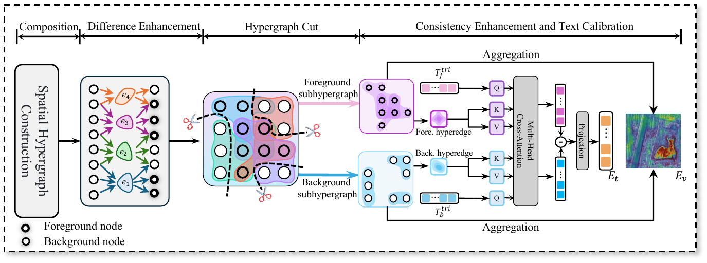
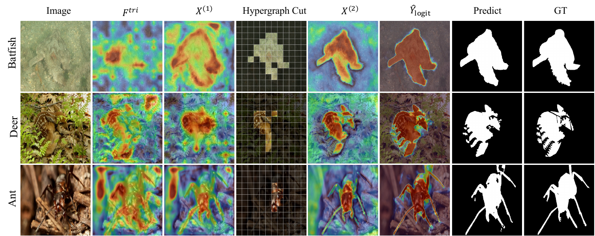

<div align="center">

# Hyper-CamoSeg

### Hypergraph Cut-Guided Feature Disentanglement for Open-Vocabulary Camouflaged Object Segmentation

[](https://github.com/ShiJinghao566/Hyper-CamoSeg)
[](AAAI方法.md)
[](https://www.python.org/)
[](https://pytorch.org/)
[](LICENSE)

**A structure-aware framework that separates visually indistinguishable foreground and background regions through semantic hypergraph cutting.**

[Overview](#overview) · [Method](#method) · [Results](#results) · [Installation](#installation) · [Training](#training) · [Evaluation](#evaluation)

</div>

> [!IMPORTANT]
> This repository is under active research development. The paper, pretrained checkpoints, and complete benchmark tables will be released when available.

## Overview

Open-vocabulary camouflaged object segmentation (OVCOS) requires a model to localize camouflaged objects at the pixel level and recognize categories that may be unseen during training. This is particularly challenging because the target often shares nearly identical color, texture, and structure with its surroundings, while conventional vision-language models favor global semantic alignment over fine-grained boundary perception.

**Hyper-CamoSeg** addresses this problem by jointly modeling cross-modal semantics and high-order visual structure. It introduces complementary foreground/background prompts, performs tripartite visual-text interaction, explicitly cuts a semantic hypergraph into foreground and background subhypergraphs, and then propagates information only within semantically consistent regions.

<p align="center">
  
</p>

## Highlights

- **Foreground-background semantic prompting.** Complementary prompt ensembles describe both the camouflaged target and its surrounding environment, providing a stronger semantic reference than foreground-only prompting.
- **Tripartite Semantic Collaborative Attention (TSCA).** Visual tokens interact with foreground and background text in both directions. Foreground responses are enhanced, background responses are suppressed, and text representations are calibrated using image context.
- **Hypergraph Cut-Guided Foreground-Background Enhancement (HFBE).** A spatial hypergraph captures high-order correlations among visual tokens. Text semantics and structural affinity jointly partition it into foreground and background subhypergraphs.
- **Disentangled two-stage propagation.** Difference enhancement is applied before the cut to expose ambiguous regions; consistency enhancement is applied after the cut to improve intra-region coherence without reintroducing cross-region contamination.
- **Hyperedge-guided text calibration.** Region-level hyperedge representations refine foreground/background text features and produce a discriminative global text prompt for mask decoding.

## Method

Given an image \(I\) and a candidate category set \(\mathcal{C}=\{c_n\}_{n=1}^{N}\), a frozen CLIP encoder extracts multi-scale visual features and foreground/background text embeddings. Hyper-CamoSeg then proceeds in four stages:

1. **Semantic collaboration:** TSCA generates foreground-aware visual features and image-adaptive foreground/background text features.
2. **High-order structure modeling:** HFBE pools spatial anchors and constructs a soft hypergraph incidence matrix connecting visual nodes to semantic region anchors.
3. **Semantic hypergraph cut:** foreground confidence is estimated from relative foreground/background text similarity and refined through structure-aware propagation. The incidence matrix is split into foreground and background components, cutting cross-semantic message-passing paths.
4. **Mask decoding and recognition:** within-subhypergraph propagation enhances regional consistency; calibrated text prompts and multi-scale visual features drive mask prediction, while masked CLIP features determine the open-vocabulary category.

### Hypergraph Cut-Guided Enhancement

<p align="center">
  
</p>

HFBE is deliberately asymmetric around the cut:

- **Before the cut**, each node is compared with its associated hyperedges to amplify differences from high-order context.
- **At the cut**, foreground/background text contrast initializes node assignments, and hypergraph structure plus visual affinity regularize the partition.
- **After the cut**, normalized hypergraph propagation is restricted to foreground or background subhypergraphs, strengthening region completeness while avoiding semantic leakage.

For a full mathematical description, see [AAAI方法.md](AAAI方法.md).

## Qualitative Analysis

<p align="center">
  
</p>

From left to right, the visualization shows the input image, TSCA feature \(F^{tri}\), difference-enhanced feature \(X^{(1)}\), the foreground/background hypergraph cut, consistency-enhanced feature \(X^{(2)}\), mask logits, the binary prediction, and ground truth. The progression illustrates how high-order structural separation suppresses background activation and recovers coherent object regions.

## Results

Hyper-CamoSeg is evaluated on **OVCamo**, which contains 14 training categories and 61 unseen test categories. Following the official OVCOS protocol, performance is measured with six category-aware segmentation metrics.

| Method | \(cS_m\) ↑ | \(cF_\beta^\omega\) ↑ | \(c\mathrm{MAE}\) ↓ | \(cF_\beta\) ↑ | \(cE_m\) ↑ | \(c\mathrm{IoU}\) ↑ |
|:--|--:|--:|--:|--:|--:|--:|
| Hyper-CamoSeg | **0.595** | **0.551** | **0.323** | **0.566** | **0.656** | **0.497** |

> [!NOTE]
> These values correspond to the current manuscript results. Complete comparisons, ablations, and checkpoint links will be added with the paper release.

## Installation

### 1. Clone the repository

```bash
git clone https://github.com/ShiJinghao566/Hyper-CamoSeg.git
cd Hyper-CamoSeg
```

### 2. Create the environment

```bash
conda create -n hypercamoseg python=3.10 -y
conda activate hypercamoseg

pip install torch==2.1.2 torchvision==0.16.2
pip install -r requirements.txt
pip install -e sam2-main
```

### 3. Prepare foundation-model checkpoints

The default setup uses:

- **CLIP ConvNeXt-L**, downloaded automatically by OpenCLIP into `pretrained/` if no local checkpoint is found;
- **SAM ViT-B** for the prompt encoder;
- **SAM 2.1 Hiera-B+** for the high-resolution mask decoder.

Place the checkpoints as follows:

```text
pretrained/
├── sam_vit_b_01ec64.pth
└── sam2.1_hiera_base_plus.pt
```

The SAM and SAM 2 checkpoints must be obtained under their respective upstream licenses. You may alternatively pass custom paths through `--checkpoint` and `--sam2-checkpoint`.

## Dataset Preparation

Download and organize the [OVCamo dataset](https://github.com/lartpang/OVCamo/releases/download/dataset-v1.0/ovcamo.zip), then update `env/splitted_ovcamo.yaml`:

```yaml
OVCamo_CLASS_JSON_PATH: "ovcamo/dataset/class_info.json"
OVCamo_SAMPLE_JSON_PATH: "ovcamo/dataset/sample_info.json"

OVCamo_TR_IMAGE_DIR: "/path/to/OVCamo/train/image"
OVCamo_TR_MASK_DIR: "/path/to/OVCamo/train/mask"
OVCamo_TR_DEPTH_DIR: "/path/to/OVCamo/train/depth"

OVCamo_TE_IMAGE_DIR: "/path/to/OVCamo/test/image"
OVCamo_TE_MASK_DIR: "/path/to/OVCamo/test/mask"
```

Expected dataset layout:

```text
OVCamo/
├── train/
│   ├── image/
│   ├── mask/
│   └── depth/
└── test/
    ├── image/
    └── mask/
```

## Training

Single-GPU training:

```bash
python main.py \
  --config configs/ovcoser.py \
  --root-info env/splitted_ovcamo.yaml \
  --model-name OVCoser \
  --clip-backbone convnext-l \
  --device cuda:0
```

Multi-GPU training with `DataParallel`:

```bash
python main.py \
  --config configs/ovcoser.py \
  --root-info env/splitted_ovcamo.yaml \
  --model-name OVCoser \
  --clip-backbone convnext-l \
  --devices 0,1
```

To evaluate after each training epoch and retain the best checkpoint:

```bash
python main.py \
  --config configs/ovcoser.py \
  --root-info env/splitted_ovcamo.yaml \
  --train-eval true \
  --train-eval-start-epoch 1
```

Experiments, logs, predictions, and checkpoints are written under `outputs/`. The current optimization and hypergraph settings are defined in `configs/ovcoser.py`.

## Evaluation

Evaluate a trained checkpoint and save category-tagged masks:

```bash
python main.py \
  --config configs/ovcoser.py \
  --root-info env/splitted_ovcamo.yaml \
  --evaluate \
  --load-from /path/to/checkpoint.pth \
  --clip-backbone convnext-l \
  --device cuda:0
```

Evaluate an existing prediction directory:

```bash
python evaluate.py \
  --pre /path/to/predictions \
  --root-info env/splitted_ovcamo.yaml
```

Prediction filenames must follow the format `[predicted_class]mask_name.png`, which is generated automatically by `main.py`.

## Repository Structure

```text
Hyper-CamoSeg/
├── configs/                         # Experiment and HFBE configuration
├── env/                             # Dataset path configuration
├── fig/                             # Framework and qualitative figures
├── methods/                         # OVCOS baseline components
├── methods_my/
│   ├── crossattforlast.py           # TSCA implementation
│   └── target_background_hypergraph.py  # HFBE implementation
├── ovcamo/                          # OVCamo metadata and utilities
├── sam2-main/                       # SAM 2 integration
├── utils/                           # Training, evaluation, and I/O utilities
├── main.py                          # Training and inference entry point
├── evaluate.py                      # Official category-aware evaluation
└── AAAI方法.md                      # Detailed method description
```

## Citation

If this project is useful to your research, please consider starring the repository. The official BibTeX entry will be provided upon publication.

## Acknowledgements

This project builds upon [OVCamo](https://github.com/lartpang/OVCamo), [OpenCLIP](https://github.com/mlfoundations/open_clip), [Segment Anything](https://github.com/facebookresearch/segment-anything), and [SAM 2](https://github.com/facebookresearch/sam2). We thank the authors for releasing their code, models, and datasets.

## License

The code in this repository is released under the [MIT License](LICENSE). Third-party code, pretrained models, and datasets remain subject to their original licenses.
